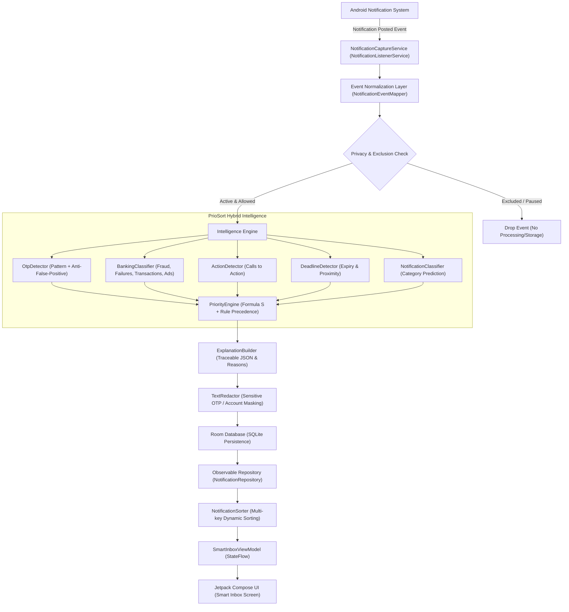

# PrioSort Architecture Specification

## 1. High-Level Architectural Overview

PrioSort is designed as a **local-first Android application** with a hybrid intelligence engine that separates notification arrival time from presentation priority. The application captures genuine Android notification events via `NotificationListenerService`, normalizes the payloads, executes on-device intelligence (rule precedence + text classification heuristics), calculates explainable mathematical priority scores, persists records locally in a Room (SQLite) database, and renders a dynamically reordered Smart Inbox using Jetpack Compose and Material 3.

---

## 2. Platform Constraint & Interface Separation

A fundamental architectural principle of PrioSort is the recognition of Android system boundaries:
1. **Original Android Notification Shade:**
   Android does not permit third-party applications to universally reposition, reorder, or manipulate notifications posted by other apps in the system tray. PrioSort does not use hacky accessibility services or root permissions.
2. **PrioSort Smart Inbox:**
   The Smart Inbox is PrioSort's primary interface where incoming notifications are displayed strictly according to calculated priority ($P_0$ Critical down to $P_4$ Minimal). A Critical notification arriving after a low-priority advertisement immediately outranks the advertisement and moves to Position #1.

---

## 3. Component Breakdown

### 3.1 Notification Capture Subsystem (`com.priosort.app.capture`)
- `NotificationCaptureService`: Android `NotificationListenerService` subclass. Receives `onNotificationPosted`, checks global capture pause state and package exclusions, and dispatches processing onto background coroutines (`Dispatchers.IO`).
- `NotificationEventMapper`: Extracts title, body, subtext, BigText extras, post timestamp, and human-readable app label from `StatusBarNotification` with robust null-safety.
- `CaptureStateManager`: Monitors listener service connection state and checks whether explicit user permission has been granted via `Settings.Secure.getString`.

### 3.2 Intelligence Subsystem (`com.priosort.app.intelligence`)
- `OtpDetector`: High-precision regular expression engine matching 4–8 digit verification passcodes accompanied by verification phrasing. Protects against false positives (e.g. order numbers, shipment tracking IDs, PNR numbers).
- `BankingClassifier`: Separates critical financial events (fraud alerts, payment failures) from routine transaction receipts and promotional banking marketing (loan/credit card offers).
- `ActionDetector`: Detects explicit calls to action (`Action required`, `Confirm now`, `Pay now`).
- `DeadlineDetector`: Parses relative deadlines (`due today`, `expires in 10 mins`) and scores proximity.
- `PriorityEngine`: Evaluates formula $S = 0.30U + 0.25A + 0.25D + 0.15I + 0.05R$ and applies deterministic overrides.
- `ExplanationBuilder`: Emits structured JSON explaining every scoring decision.

### 3.3 Sorting Subsystem (`com.priosort.app.sorting`)
- `NotificationSorter`: Pure sorting function with zero UI coupling:
  1. `isPinned` descending
  2. `priorityLevel.rank` descending ($P_0=5$ down to $P_4=1$)
  3. `deadlineScore` descending
  4. `receivedAt` descending (newest first for identical rank)
  5. Stable identifier ascending (deterministic tie-breaker)

### 3.4 Data Persistence Subsystem (`com.priosort.app.data`)
- Room over SQLite (`PrioSortDatabase`) with indexed tables (`notifications`, `app_preferences`, `package_settings`).
- Thread-safe repository layer exposing Kotlin Coroutines `Flow` streams for reactive UI updates without blocking the Android main thread.

### 3.5 UI Presentation Subsystem (`com.priosort.app.ui`)
- Material 3 Jetpack Compose UI.
- `SmartInboxScreen`: Displays dynamic priority-ordered list, KPI counter cards (Critical & High), search bar, and priority filter chips.
- `NotificationDetailScreen`: Inspects mathematical score formula breakdown, explainability traces, and exposes user feedback controls (change priority, change category, pin, exclude application).
- `SettingsScreen`: Privacy toggles, OTP redaction toggle, data retention slider, and database wipe.
- `AnalyticsScreen`: Visual breakdown of priority distribution and OTP detection performance.

---

## 4. Advanced Production Features (Phase 2 Additions)

### 4.1 Time-of-Day Context & Focus Modes
The system introduces contextual Focus Modes (`com.priosort.app.intelligence.FocusModeEngine`):
- **Work Mode:** Automatically elevates `WORK_AND_EDUCATION` notifications to $P_1$ (High), demotes casual `PERSONAL_AND_SOCIAL` messages to $P_3$ (Low), and suppresses `PROMOTIONAL` notifications to $P_4$ (Minimal).
- **Sleep / Do Not Disturb Mode:** Demotes all non-essential notifications to $P_3$/$P_4$ while **guaranteeing complete immunity for $P_0$ Critical alerts (OTPs & Fraud Alerts)**.
- **Personal Leisure Mode:** Prioritizes social and family interactions while demoting work tasks.

### 4.2 Near-Duplicate & Spam Burst Suppression (`BurstDetector`)
Detects rapid successive notifications from the same sender or application within a 3-minute sliding window. Notifications exceeding the threshold are consolidated into a single card with an aggregated count badge (`[x3 messages]`), preventing chatty group chats or shopping apps from crowding out time-sensitive alerts.

### 4.3 Custom Rules Engine (`CustomRuleMatcher`)
Allows users to define structured keyword rules:
- Pattern: Keyword + Target Field (Title, Body, Package) $\to$ Target Priority ($P_0$ to $P_4$) or Target Category.
- Persisted in Room database (`custom_rules` table).

### 4.4 One-Tap Safe Copy OTP Action
In the Smart Inbox, detected verification codes feature a dedicated **"Copy OTP" button** directly on the card. The UI displays the masked preview while copying the raw passcode to the system clipboard for seamless authentication.

### 4.5 Dual View: Ranked Stream vs Priority Sections
Users can toggle between a continuous dynamic priority stream and a **Priority Tier Section View**, organizing notifications under distinct visual headers:
- 🔴 Critical ($P_0$) — Immediate attention
- 🟠 High ($P_1$) — Important alerts & deadlines
- 🔵 Medium ($P_2$) — Routine personal & transactional updates
- 🟢 Low ($P_3$) — General information
- ⚪ Minimal ($P_4$) — Promotional campaigns & ads

### 4.6 Interactive In-App Notification Sandbox
A floating sandbox generator in the Android application permits instant injection and testing of custom notifications or 1-tap presets (Banking OTP, Fraud Alert, Quiz Deadline, Flash Sale) directly on an emulator or physical device without external triggers.

### 4.7 Smart Notification Snooze & Alarm Escalation
Users can snooze notifications via predefined presets (`SnoozePreset`: 15m, 1h, 3h, Tomorrow 9 AM). When snoozed, the record is temporarily filtered out of active queries until `snoozedUntilMs <= currentTimeMs`. Once expired, the notification resurfaces at the top with an escalated recency/urgency factor.

### 4.8 Delivery & Logistics Stage Parser (`DeliveryTracker`)
Identifies parcel lifecycle events across delivery apps (Amazon, Flipkart, Swiggy, Zomato, Delhivery, BlueDart, DTDC). `OUT_FOR_DELIVERY` events are elevated to $P_1$ (High) with a courier badge and 1-tap delivery verification code extraction.

### 4.9 On-Device Financial Ledger & Spend Analytics (`FinanceLedger`)
Maintains an offline financial ledger by parsing debits, credits, currencies, and merchant entities from transaction alerts, computing total expenditures and credits in Room SQLite without telemetry or remote API calls.

### 4.10 VIP Senders & Critical Contacts Whitelist (`VipManager`)
Whitelists critical sender names and phone contacts (e.g. "Mom", "Dad", "Doctor", "Boss"), automatically promoting incoming notifications to $P_1$ (High).
