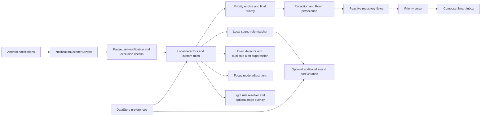

# PrioSort architecture

## Android runtime

Notification content is handled locally. Android notification access is user-granted and can be revoked. The listener does not change the system shade or control source apps' original sounds. New sound rules can add a PrioSort alert only when a matching rule exists and global sound is enabled; quiet hours and silent rules suppress that additional alert. Duplicate notification events do not trigger repeated custom sounds.

Room stores notification history, custom priority, sound, light and feedback records, including the extracted transaction currency and any resolved deadline timestamp. DataStore persists sound, volume, vibration, quiet-hours, theme, focus modes, category priority and VIP-contact preferences. Coroutines and Flow/StateFlow deliver updates to the UI. WorkManager cleans expired records, ends expired snoozes and posts user-confirmed generic reminders, subject to Android scheduling and notification permission. Burst detection uses same-package title/body similarity over a three-minute window; it labels records and suppresses extra PrioSort sound/light effects once three similar alerts are seen. It does not merge records. Deadline parsing only assigns timestamps to explicit relative durations or explicit local dates; vague deadline signals remain unresolved.

## Offline Python tools

The `python/` tree contains local synthetic-data generation, a TF-IDF model, command-line analysis and a Streamlit dashboard. It is an offline development utility; the Android app has no network permission and does not connect to Python or transmit notification content. Synthetic evaluation results do not establish real-world accuracy; see [model_evaluation.md](model_evaluation.md).

## Privacy boundary and platform limits

Redaction masks known OTP and account/card patterns before persistence when enabled; detection is heuristic and can miss sensitive content. The Room database is app-private but not separately encrypted by PrioSort. Android's sandbox and device security are relied upon. The project disables app backup. Custom sound URIs can become unavailable if their source is removed or access is revoked; the app should report the failure and let the user choose another file.
