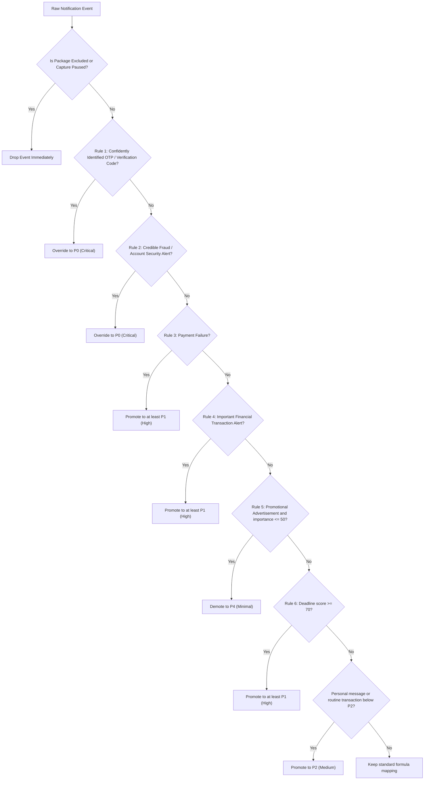

# PrioSort Priority Policy Specification

## 1. Mathematical Scoring Formula

PrioSort evaluates base priority through a transparent, weighted formula:

$$S = 0.30U + 0.25A + 0.25D + 0.15I + 0.05R$$

Where each component is normalized between $0.0$ and $100.0$:
- **$U$ (Urgency):** Reflects the intrinsic time-sensitivity of the notification content.
  - Confirmed OTP / Security Verification: $100$
  - Suspected Fraud / Account Compromise: $95$
  - Payment Failure / Margin Call: $85$
  - Active Work/Education Deadline: $80$
  - Important High-Value Transaction: $75$
  - Routine Financial Confirmation: $65$
  - Work/Team Collaboration: $60$
  - Personal Communication: $45$
  - Routine Informational Update: $30$
  - Promotional Advertisement: $10$
- **$A$ (Action Requirement):** In the current Android implementation, OTPs and detected fraud/payment failures score $100$; configured explicit action phrases score $75$; other notifications score $0$. A separate $50$ potential-action score is not currently produced by the Kotlin action detector.
- **$D$ (Deadline Proximity):** The current Kotlin detector uses text heuristics. Expiry in at most one hour scores $100$; expiry in up to 24 hours scores $90$; longer explicit hour offsets score $70$. “Due today” scores $90$, “due tomorrow” scores $70$, and generic deadline phrases score $70$. Unrecognized/no deadline scores $0$. Calendar dates and the 1–7 day bands are not currently resolved.
- **$I$ (User-Defined Importance):**
  - Configurable application-specific or category-specific importance rating (Default: $50$).
- **$R$ (Recency Exponential Decay):**
  $$R = 100 \times \exp\left(-\frac{\text{age\_hours}}{\tau}\right)$$
  Where $\tau$ is the decay time constant (default $\tau = 24.0$ hours). Freshly received notifications receive $R \approx 100$; the score halves after about 16.6 hours.

---

## 2. Default Score-to-Priority Mapping

| Score Range ($S$) | Priority Level | Display Name | Rank |
| :--- | :--- | :--- | :--- |
| $80.00$ – $100.00$ | $P_0$ | Critical | 5 |
| $60.00$ – $79.99$ | $P_1$ | High | 4 |
| $35.00$ – $59.99$ | $P_2$ | Medium | 3 |
| $15.00$ – $34.99$ | $P_3$ | Low | 2 |
| $0.00$ – $14.99$ | $P_4$ | Minimal | 1 |

---

## 3. Deterministic Rule Precedence Hierarchy

The raw mathematical score $S$ can be overridden by domain rules. The base score remains stored separately from the final priority. The rules below summarize the Kotlin engine; the capture pipeline then applies category preferences, matching custom priority rules, VIP elevation, and out-for-delivery elevation. OTP and fraud priorities are protected from category/custom priority changes.

After these engine rules, user category preferences and custom priority rules can set a different priority (except for detected OTPs and fraud alerts). VIP contacts and out-for-delivery status can then raise a lower priority to High.

---

## 4. Separation of Category and Priority

Category describes **what** a notification concerns; Priority describes **how urgently** it requires attention.

| Notification Content | Category | Priority Level | Justification |
| :--- | :--- | :--- | :--- |
| "Your HDFC NetBanking OTP is 482731" | Security & Verification | $P_0$ (Critical) | High-confidence verification code, urgent action |
| "HDFC: Pre-approved Credit Card with 10k bonus points" | Promotional | $P_4$ (Minimal) | Marketing promotion, no action deadline |
| "Payment of Rs 3,200 to Electricity Board failed" | Financial & Transactional | $P_1$ (High) | Payment failure requiring prompt rectification |
| "Rs 150 debited at Starbucks via UPI" | Financial & Transactional | $P_2$ (Medium) | Routine receipt |
| "Assignment 3 is due today at 11:59 PM" | Work & Education | $P_1$ (High) | Submission deadline within 24 hours |
| "Mom: Emergency, please call me" | Personal & Social | $P_2$ (Medium) | Personal messages are raised to at least Medium; this wording alone is not a configured urgent-message trigger |
| "Rahul: Hey, what time are we meeting?" | Personal & Social | $P_2$ (Medium) | Routine casual message |
| "Flipkart: Flat 50% discount on shoes" | Promotional | $P_4$ (Minimal) | Promotional advertisement |
