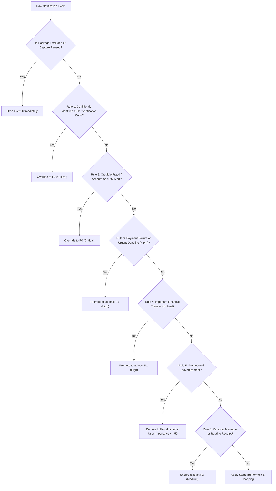

# PrioSort Priority Policy Specification

## 1. Mathematical Scoring Formula

PrioSort evaluates base priority through a transparent, weighted formula:

$$S = 0.30U + 0.25A + 0.25D + 0.15I + 0.05R$$

Where each component is normalized between $0.0$ and $100.0$:
- **$U$ (Urgency):** Reflects the intrinsic time-sensitivity of the notification content.
  - Confirmed OTP / Security Verification: $100$
  - Suspected Fraud / Account Compromise: $95$
  - Payment Failure / Margin Call: $85$
  - Active Work/Education Deadline: $80$
  - Important High-Value Transaction: $75$
  - Routine Financial Confirmation: $65$
  - Work/Team Collaboration: $60$
  - Personal Communication: $45$
  - Routine Informational Update: $30$
  - Promotional Advertisement: $10$
- **$A$ (Action Requirement):**
  - Explicit action required (Passcode entry, Fraud review, Pay now): $100$
  - Urgent review requested (Action keywords detected): $75$
  - Potential action required (Submission due): $50$
  - Informational / No action detected: $0$
- **$D$ (Deadline Proximity):**
  - Imminent expiry within $1$ hour: $100$
  - Expiry or deadline within $24$ hours (e.g. Due today): $90$
  - Deadline within $1$ to $2$ days (e.g. Due tomorrow): $70$
  - Deadline between $3$ and $7$ days: $40$
  - Deadline more than $7$ days away: $20$
  - No deadline resolved: $0$
- **$I$ (User-Defined Importance):**
  - Configurable application-specific or category-specific importance rating (Default: $50$).
- **$R$ (Recency Exponential Decay):**
  $$R = 100 \times \exp\left(-\frac{\text{age\_hours}}{\tau}\right)$$
  Where $\tau$ is the decay half-life parameter (default $\tau = 24.0$ hours). Freshly received notifications receive $R \approx 100$.

---

## 2. Default Score-to-Priority Mapping

| Score Range ($S$) | Priority Level | Display Name | Rank |
| :--- | :--- | :--- | :--- |
| $80.00$ – $100.00$ | $P_0$ | Critical | 5 |
| $60.00$ – $79.99$ | $P_1$ | High | 4 |
| $35.00$ – $59.99$ | $P_2$ | Medium | 3 |
| $15.00$ – $34.99$ | $P_3$ | Low | 2 |
| $0.00$ – $14.99$ | $P_4$ | Minimal | 1 |

---

## 3. Deterministic Rule Precedence Hierarchy

The raw mathematical score $S$ can be overridden by explicit, high-confidence domain rules. PrioSort never alters the mathematical score to disguise an override; both the base score and the override reason are stored and displayed.

---

## 4. Separation of Category and Priority

Category describes **what** a notification concerns; Priority describes **how urgently** it requires attention.

| Notification Content | Category | Priority Level | Justification |
| :--- | :--- | :--- | :--- |
| "Your HDFC NetBanking OTP is 482731" | Security & Verification | $P_0$ (Critical) | High-confidence verification code, urgent action |
| "HDFC: Pre-approved Credit Card with 10k bonus points" | Promotional | $P_4$ (Minimal) | Marketing promotion, no action deadline |
| "Payment of Rs 3,200 to Electricity Board failed" | Financial & Transactional | $P_1$ (High) | Payment failure requiring prompt rectification |
| "Rs 150 debited at Starbucks via UPI" | Financial & Transactional | $P_2$ (Medium) | Routine receipt |
| "Assignment 3 is due today at 11:59 PM" | Work & Education | $P_1$ (High) | Submission deadline within 24 hours |
| "Mom: Emergency, please call me" | Personal & Social | $P_1$ (High) | Urgent personal message |
| "Rahul: Hey, what time are we meeting?" | Personal & Social | $P_2$ (Medium) | Routine casual message |
| "Flipkart: Flat 50% discount on shoes" | Promotional | $P_4$ (Minimal) | Promotional advertisement |
